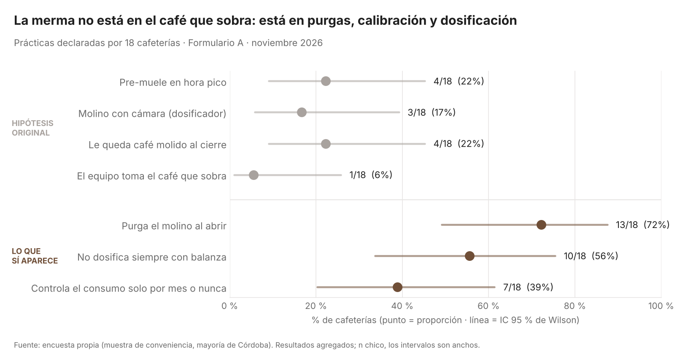

# ☕ El problema del vaso lleno de café

> **¿Cuánto café molido termina en la basura de una cafetería take away al final de cada turno, por qué pasa, y cómo convertir esa pérdida en información y en ganancia, sin venderle café viejo al cliente ni darle "las sobras" al equipo?**

Proyecto de investigación aplicada de la carrera **Técnico Superior en Ciencia de Datos e Inteligencia Artificial** (Argentina).
Autor: **Joaquín** · Proyecto independiente (no forma parte de la tesis de tueste) · Licencia [MIT](LICENSE).

---

## 1. Resumen ejecutivo

En una cafetería take away, cada extracción de espresso o cada filtrado deja pequeñas pérdidas de café molido: **purgas del molino, retención en la cámara de molienda, shots de calibración, shots descartados, dosis pasadas de peso, café pre-molido que nadie usa y lotes de filtrado sobredimensionados**. Ninguna de esas pérdidas se ve en el momento; se ven a fin de mes, cuando el **consumo de café registrado en el stock no coincide con lo que se vendió en caja**.

> 🔄 **Actualización 2026-11-25 · validación de campo:** la encuesta a 18 cafeterías (Formulario A) **no confirmó** que la merma venga del café pre-molido ni del sobrante al cierre. Lo que sí apareció es merma en **calibración, purgas y dosificación sin balanza**, con poco control diario. La problemática se reformuló en consecuencia: ver [`docs/10-validacion-formulario-A.md`](docs/10-validacion-formulario-A.md).



Este repositorio documenta el análisis completo del problema siguiendo una estructura de 6 fases:

| # | Fase | Documento |
|---|------|-----------|
| 0 | Marco metodológico (herramientas y reglas anti-sesgo) | [`docs/00-marco-metodologico.md`](docs/00-marco-metodologico.md) |
| 1 | Arquitectura de decisión | [`docs/01-arquitectura-de-decision.md`](docs/01-arquitectura-de-decision.md) |
| 2 | Problemática y justificación (árbol, 5 porqués, Pareto, prioridad) | [`docs/02-problematica.md`](docs/02-problematica.md) |
| 3 | Objetivo general | [`docs/03-objetivo-general.md`](docs/03-objetivo-general.md) |
| 4 | Objetivos específicos | [`docs/04-objetivos-especificos.md`](docs/04-objetivos-especificos.md) |
| 5 | Estructura de la solución | [`docs/05-estructura-solucion.md`](docs/05-estructura-solucion.md) |
| 6 | Evaluación de la solución | [`docs/06-evaluacion-solucion.md`](docs/06-evaluacion-solucion.md) |
| 7 | Solución tecnológica (Ciencia de Datos e IA) y alcance | [`docs/07-solucion-tecnologica-y-alcance.md`](docs/07-solucion-tecnologica-y-alcance.md) |
| 8 | Examen socrático (council-socrates) | [`docs/08-council-socrates.md`](docs/08-council-socrates.md) |
| 9 | Guía de relevamiento en campo | [`docs/09-guia-relevamiento-campo.md`](docs/09-guia-relevamiento-campo.md) |
| 10 | **Validación de campo · Formulario A** (18 respuestas) | [`docs/10-validacion-formulario-A.md`](docs/10-validacion-formulario-A.md) |

Material de soporte:

- [`data/plantilla_registro_mermas.csv`](data/plantilla_registro_mermas.csv) → plantilla para registrar mermas en el local.
- [`data/diccionario_de_datos.md`](data/diccionario_de_datos.md) → definición de cada variable.
- [`data/mermas_SIMULADO.csv`](data/mermas_SIMULADO.csv) → **datos simulados** (no reales) para probar el pipeline.
- [`notebooks/01_pareto_y_rendimiento.ipynb`](notebooks/01_pareto_y_rendimiento.ipynb) → KPIs, Pareto 80/20 y escenarios hacia el 15 %.
- [`formularios/`](formularios/) → script de Google Apps Script que crea el Formulario A y su planilla de respuestas.

---

## 2. La tesis en una frase

> **Primero medir, después reducir, y recién al final valorizar lo que quede.**

El examen socrático del proyecto (ver doc 08) detectó que los dos objetivos específicos originales **compiten entre sí**: si el local logra bajar el desperdicio (Objetivo 2), se queda sin materia prima para el producto elaborado con ese desperdicio (Objetivo 1). Por eso la solución se ordena con la **jerarquía de residuos**:

```
1. PREVENIR   → no moler lo que no se va a usar (molienda a demanda, dosis por peso, lotes de filtrado según demanda)
2. MEDIR      → saber cuánto, dónde, cuándo y por qué se pierde (registro + conciliación stock vs. caja)
3. VALORIZAR  → transformar el residuo inevitable (cold brew/repostería interna con trazabilidad)
4. DISPONER   → borra y café no apto → compost/jardín, nunca al cliente
```

---

## 3. Estado del proyecto

| Fase | Estado |
|------|--------|
| Definición de la problemática | ✅ Hipótesis formulada (v1) · 🔄 reformulada tras la encuesta (v2) |
| Encuesta a cafeterías (Formulario A) | ✅ 18 respuestas · hipótesis R1 (pre-molido) refutada |
| Entrevistas y medición de línea base en barra (Formulario B) | ⏳ Pendiente · **prioridad** |
| Pareto con datos reales | ⏳ Pendiente (hoy: datos simulados con la hipótesis v1) |
| MVP de registro y tablero | ⏳ Pendiente |
| Piloto de valorización | ⏳ Pendiente |

> ⚠️ **Advertencia de honestidad metodológica:** todos los números de este repositorio que no tengan fuente son **supuestos o datos simulados**, marcados como tales. La problemática se considera *hipótesis* hasta que la medición de línea base en al menos una cafetería real la confirme o la refute. Las respuestas individuales de la encuesta **no se publican** (consentimiento de uso agregado); solo los resultados del doc 10.

---

## 4. Cómo usar este repositorio

```bash
git clone https://github.com/iesjoaco7-cyber/el-problema-del-vaso-lleno-de-cafe.git
cd el-problema-del-vaso-lleno-de-cafe
pip install pandas numpy matplotlib jupyter
jupyter notebook notebooks/01_pareto_y_rendimiento.ipynb
```

Para reemplazar los datos simulados por datos reales: completá `data/plantilla_registro_mermas.csv` durante el relevamiento y cambiá la variable `RUTA_DATOS` en la primera celda del notebook.
