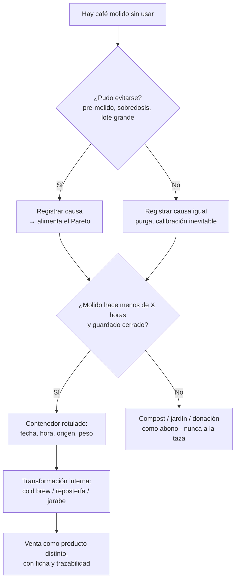

# 01 · Arquitectura de decisión

La arquitectura de decisión define **quién decide qué, con qué información, con qué criterios y en qué momento**. Sin ella, el desperdicio "no es de nadie": el barista no lo ve, el encargado lo intuye y el dueño lo descubre a fin de mes.

## 1. Actores y decisiones

| Actor | Decisiones que toma | Frecuencia | Información que hoy tiene | Información que necesita |
|---|---|---|---|---|
| **Barista** | Cuánto moler, cuándo purgar, cuándo descartar un shot, cuánto filtrado preparar | Cada bebida | Experiencia, sabor, tiempo de extracción | Dosis objetivo en gramos, demanda esperada por franja |
| **Encargado de turno** | Calibración de molienda, tamaño de lotes de filtrado, qué hacer con el sobrante | Por turno | Lo que ve en la barra | Registro de mermas del turno, sobrante pesado |
| **Dueño / administración** | Compra de café, equipamiento (molino), capacitación, nuevos productos | Semanal / mensual | Facturas de compra y cierre de caja | Tasa de merma, costo de la merma, gramos por taza reales |

## 2. Niveles de decisión

| Nivel | Pregunta | Ejemplo |
|---|---|---|
| **Operativo** (segundos-minutos) | ¿Muelo ahora o espero el pedido? | Molienda a demanda vs. pre-moler |
| **Táctico** (turno-semana) | ¿Cuánto filtrado preparo de 15 a 17 h? ¿Qué hago con el sobrante? | Lote según pronóstico; sobrante → cold brew del día siguiente |
| **Estratégico** (mes-año) | ¿Cambio el molino? ¿Lanzo un producto con el residuo? | Inversión en molino de baja retención; línea de cold brew |

## 3. Criterios de decisión (ponderables)

| Criterio | Pregunta de control | Peso sugerido `[SUPUESTO]` |
|---|---|---|
| **Calidad de la taza** | ¿La decisión empeora el café que recibe el cliente? | 30 % |
| **Impacto económico** | ¿Cuántos ARS/mes ahorra o genera? | 25 % |
| **Impacto en la producción** | ¿Aumenta el tiempo de espera o frena la barra en hora pico? | 20 % |
| **Factibilidad / costo** | ¿Se puede hacer con lo que hay o requiere inversión? | 15 % |
| **Ética y legalidad** | ¿Es transparente con el cliente y digno para el equipo? ¿Cumple la normativa alimentaria? | Filtro excluyente (si falla, se descarta) |
| **Medibilidad** | ¿Podemos verificar si funcionó? | 10 % |

> La ética funciona como **filtro**, no como peso: una opción que implique venderle al cliente café viejo como si fuera fresco, o darle al equipo sólo sobras, queda descartada aunque sume puntos en lo económico.

## 4. Flujo de decisión para el café molido sobrante



`X` (ventana máxima de horas) se define en el piloto mediante cata comparativa; propuesta inicial `[SUPUESTO]`: **≤ 12 h en recipiente hermético** para el uso en cold brew.

## 5. Arquitectura de la información (de dónde sale cada dato)

```
Compras / stock (kg de café ingresado y egresado)  ─┐
POS / caja (bebidas vendidas por tipo y hora)      ─┼─► Conciliación diaria ─► Tasa de merma ─► Tablero ─► Decisiones
Registro de mermas en barra (g, causa, hora)       ─┤                                    ▲
Sobrante pesado al cierre (g)                      ─┘                                    │
Receta estándar (g por bebida)  ─────────────────────────────────────────────────────────┘
```
