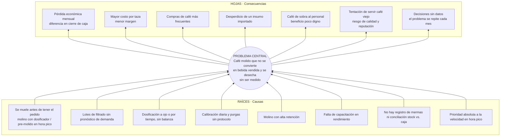

# 02 · Problemática y justificación

> 🔄 **Estado de la hipótesis (2026-11-25):** la encuesta a 18 cafeterías refutó la raíz **R1** (pre-molido: 78 % nunca pre-muele) y no encontró sobrante al cierre en el 78 % de los locales. Se sostienen **R3** (56 % no dosifica siempre con balanza), **R4** (calibración y purgas ≈ 8 % del café diario) y **R7** (39 % controla el consumo solo una vez por mes o nunca). Este documento conserva la **versión 1** por trazabilidad; ver la versión 2 abajo y el detalle en [`10-validacion-formulario-A.md`](10-validacion-formulario-A.md).

## 1. Enunciado de la problemática

### Versión 2 (vigente, tras la validación de campo)

> **En las cafeterías de especialidad, el café que se pierde en calibraciones, purgas y dosificación sin balanza no se registra durante el turno. La mayoría muele a demanda y no le sobra café al cierre, pero tampoco mide cuánto café usa por taza real ni cuánto se va en cada ajuste del molino, por lo que la pérdida queda invisible y no se puede reducir.**

Nueva hipótesis de Pareto a verificar en barra: **calibración + purgas + sobredosis**.

### Versión 1 (original, parcialmente refutada)

> **En las cafeterías take away, el café molido que no termina en una bebida vendida (purgas, retención, calibraciones, shots descartados, sobredosis, café pre-molido y lotes de filtrado sobrantes) no se registra ni se mide durante el turno. La pérdida solo aparece de forma agregada al cierre mensual, como una diferencia entre el café consumido del stock y el café vendido en caja, cuando ya no se puede saber dónde, cuándo ni por qué ocurrió. Como el café molido pierde calidad en minutos u horas, ese sobrante no puede volver a la taza y termina desechado o entregado al personal como "sobra", lo que genera pérdida económica, desaprovecha un insumo caro e importado y resulta poco digno como beneficio para el equipo.**

Versión corta: **"Se pierde café todos los días, pero sólo se ve una vez por mes."**

## 2. Definición operativa (qué se mide y qué no)

| Concepto | ¿Es merma? | Motivo |
|---|---|---|
| Café molido que no llegó a una bebida vendida | ✅ Sí | Es insumo pagado que no generó ingreso |
| Shots descartados / rehechos | ✅ Sí | El café se extrajo pero no se vendió |
| Exceso de dosis sobre la receta (ej. 19,5 g en lugar de 18 g) | ✅ Sí | Es café regalado dentro de la taza |
| Café en grano vencido o rancio en stock | ✅ Sí (categoría aparte) | Se registra, pero no es merma de barra |
| **Borra** (café ya extraído de una bebida vendida) | ❌ No | Es el residuo normal de un producto vendido |
| Café para consumo del personal **planificado** | ❌ No, es "consumo interno" | Se registra como beneficio, no como pérdida |

**Fórmula de la tasa de merma (KPI principal):**

```
                          café egresado del stock − café teórico vendido
Tasa de merma (%) =  ───────────────────────────────────────────────────── × 100
                                   café egresado del stock

café teórico vendido = Σ (bebidas vendidas por tipo × gramos de la receta estándar)
```

**KPI de rendimiento (gramos por taza real):** `café egresado / bebidas vendidas`, comparado con los gramos de receta.

## 3. Diagrama de árbol (raíces → problema → hojas)



> **Observación clave del árbol:** la raíz **R7 (no hay medición)** es transversal: no genera la pérdida por sí misma, pero hace que todas las otras raíces sean **invisibles**. Es la raíz sobre la que el perfil de Ciencia de Datos tiene más impacto directo.

## 4. Los 5 porqués

**Síntoma:** a fin de mes falta café en el balance (se consumió más café del que se vendió).

| # | Pregunta | Respuesta (hipótesis a validar en campo) |
|---|---|---|
| 1 | ¿Por qué falta café en el balance? | Porque se usa más café molido del que exigen las bebidas vendidas. |
| 2 | ¿Por qué se usa más café del necesario? | Porque se muele de más (pre-molido, lotes grandes de filtrado, sobredosis) y se descarta lo que sobra o lo que se oxidó. |
| 3 | ¿Por qué se muele de más? | Porque en hora pico se prioriza la velocidad y se anticipa la demanda "a ojo", sin dosis por peso ni pronóstico. |
| 4 | ¿Por qué se anticipa a ojo? | Porque nadie sabe cuánto se pierde, en qué momento ni por qué causa: no hay registro durante el turno. |
| 5 | ¿Por qué no hay registro? | Porque el control del café se hace sólo con el inventario mensual y la facturación, y no existe un proceso ni una herramienta simple que conecte **lo que se muele** con **lo que se vende**. |

**Causa raíz:** *ausencia de un sistema de medición y conciliación diaria entre el café utilizado y el café vendido, que haga visible la merma por causa y permita decidir con datos.*

## 5. Ley de Pareto (80/20)

> ⚠️ **Datos SIMULADOS** (notebook 01). La estructura del análisis es la definitiva; los valores se reemplazan con la línea base real.

Escenario simulado: cafetería take away con ~180 bebidas de espresso y ~40 filtrados por día, 30 días.

| # | Causa | Evitable | % de la merma | % acumulado | Zona |
|---|---|---|---|---|---|
| 1 | Café pre-molido sobrante | Sí | 50,2 % | 50,2 % | **A** |
| 2 | Lote de filtrado sobrante | Sí | 20,7 % | 70,9 % | **A** |
| 3 | Sobredosis (dosis > receta) | Sí | 10,3 % | 81,2 % | **A** |
| 4 | Shots de calibración | No | 5,4 % | 86,6 % | B |
| 5 | Purgas | No | 5,1 % | 91,7 % | B |
| 6 | Shots descartados | Sí | 4,3 % | 96,0 % | B |
| 7 | Derrames | Sí | 2,4 % | 98,4 % | B |
| 8 | Retención al cierre | No | 1,6 % | 100 % | B |

Resultado simulado: **3 de 8 causas (37 %) explican el 81 % de los gramos perdidos**. Tasa de merma simulada: **23,9 %**; el local usaría **22,9 g por taza** contra **17,5 g de receta**.

**Hipótesis de Pareto a verificar:** *la mayor parte de la merma no viene de los procesos "técnicos" inevitables (purga, calibración), sino de decisiones de anticipación (moler antes, preparar de más, dosificar sin balanza).* Si el relevamiento muestra lo contrario (por ejemplo, que el molino tiene una retención enorme), **la prioridad de la solución cambia** hacia el equipamiento.

## 6. Orden de prioridad (matriz impacto × esfuerzo)

| Causa / intervención | Impacto (1-5) | Esfuerzo (1-5) | Cuadrante | Prioridad |
|---|---|---|---|---|
| R7 · Registro + conciliación diaria | 5 | 2 | Ganancia rápida | **1** |
| R3 · Dosificar con balanza | 4 | 1 | Ganancia rápida | **2** |
| R1 · Molienda a demanda en hora pico | 5 | 3 | Proyecto mayor | **3** |
| R2 · Lote de filtrado según pronóstico por franja | 4 | 3 | Proyecto mayor | **4** |
| R4 · Protocolo de calibración y purga | 2 | 1 | Relleno | 5 |
| R6 · Capacitación en rendimiento | 3 | 2 | Ganancia rápida | 6 (transversal) |
| R5 · Cambiar a molino de baja retención | 3 | 5 | Cuestionable | 7 (sólo si el Pareto real lo justifica) |

## 7. Justificación

### 7.1 Económica
- El café es un insumo caro en Argentina: un relevamiento de 2026 ubicó el precio promedio de un café en locales en torno a **$3.200** `[FUENTE 1]`, y un kilo de café de especialidad en grano se encuentra entre **~$34.000 y ~$71.000** en el canal minorista `[FUENTE 2, 3]`.
- El país **importa todo el café** que consume y el insumo tuvo fuertes aumentos `[FUENTE 4]`; cada gramo perdido tiene un costo de reposición alto.
- En el escenario simulado, la merma equivale a **~38 kg/mes (~2.200 tazas no vendidas)** y a **~$1,5 M ARS/mes** con un precio supuesto de $40.000/kg `[SIMULADO + SUPUESTO]`.

### 7.2 Técnica y de calidad
- El café molido pierde aroma muy rápido; fuentes del sector indican que la frescura se degrada en **minutos** y que conviene moler inmediatamente antes de preparar `[FUENTE 5, 6]`. Esto confirma que el sobrante **no debe volver a la taza** como espresso o filtrado.
- Los molinos comerciales retienen café y requieren purgas: se reportan purgas de **3-5 g** en molinos tradicionales `[FUENTE 7]` y casos de cafeterías que purgan **12 g** tras un minuto de inactividad `[FUENTE 8]`. Es una merma pequeña por evento, pero constante.

### 7.3 Humana y ética
- Darle al personal el café sobrante como beneficio convierte un derecho (tomar un buen café en el trabajo) en una "sobra". La solución propone **separar contablemente el consumo interno digno** de la merma.

### 7.4 Ambiental
- Reducir el café molido desechado disminuye el desperdicio de un producto con una cadena de suministro larga (importación, tueste, transporte).

### 7.5 Profesional (por qué es un problema de Ciencia de Datos)
- El problema central no es la falta de recetas para usar café viejo: es la **falta de datos**. Medición, conciliación, Pareto, pronóstico de demanda y detección de anomalías son herramientas propias del perfil.

## Fuentes

1. Canal 26 / Fudo (jul. 2026) – precio promedio del café en locales: https://www.canal26.com/economia/2026/07/24/el-cafe-mas-barato-del-pais-esta-en-el-norte-argentino-cuesta-menos-de-2600-pesos-en-estas-tres-provincias/
2. MejoresCompras – café de especialidad 1 kg (Perú): https://mejorescompras.com.ar/precio/MLA2076033106--cafe-de-especialidad-peru-chirimoya-porto-espreso-1kg
3. MejoresCompras – café de especialidad 1 kg (Colombia): https://mejorescompras.com.ar/precio/MLA2056225006--cafe-de-especialidad-colombia-antioquia-porto-espreso-1kg
4. iProfesional – café importado y aumentos: https://www.iprofesional.com/economia/365664-tomar-un-cafe-un-lujo-en-la-argentina-estos-son-los-precios
5. Ratio Coffee – fresh grind vs fresh brew: https://ratiocoffee.com/blogs/coffee-guides/the-flavor-difference-between-a-fresh-grind-and-a-fresh-brew
6. Complete Home Barista – vida útil del café molido: https://completehomebarista.com/faqs/beans-storage/pre-ground-vs-whole-bean-shelf-life/
7. The Environmental Blog – purgas en molinos comerciales: https://www.theenvironmentalblog.org/?p=9060
8. Daily Coffee News – David Schomer, retención y purgas: https://dailycoffeenews.com/2019/08/30/a-call-to-action-on-espresso-grinders-by-david-schomer/
