# 05 · Estructura de la solución

La solución tiene **tres componentes** (proceso, datos y producto) y se implementa en **cuatro etapas**.

## 1. Componentes

### A · Proceso en barra (prevención)

| Intervención | Causa que ataca | Cómo se hace | Costo |
|---|---|---|---|
| **Dosificar por peso** | Sobredosis | Balanza de 0,1 g en la estación de molienda; dosis objetivo visible | Bajo |
| **Molienda a demanda** | Café pre-molido sobrante | Moler sólo al recibir el pedido; si el molino tiene dosificador de paletas, mantener la cámara vacía y moler por porción | Bajo-medio |
| **Lotes de filtrado por pronóstico** | Lote de filtrado sobrante | Tabla de tamaño de lote por franja horaria (sale del módulo de pronóstico) | Bajo |
| **Protocolo de calibración y purga** | Calibración / purgas | Purga fija pesada, calibración con registro y máximo de shots de ajuste | Nulo |
| **Rutina de cierre** | Retención y sobrante final | Pesar y registrar todo sobrante antes de decidir su destino | Nulo |

### B · Sistema de datos (medición y decisión)

1. **Registro en barra** (planilla o formulario en el celular): gramos, causa, hora, turno.
2. **Conciliación diaria**: café egresado del stock vs. bebidas vendidas en caja × receta.
3. **Tablero (dashboard)**: tasa de merma, gramos por taza, Pareto, evolución diaria, alertas.
4. **Pronóstico de demanda por franja**: para dimensionar lotes de filtrado y la preparación previa a la hora pico.

### C · Producto de valorización (residuo inevitable)

**Cold brew del local**, con este protocolo base `[SUPUESTO – a validar en piloto]`:

1. El sobrante apto se guarda en **recipiente hermético rotulado** (fecha, hora de molienda, origen, gramos).
2. Ventana máxima desde la molienda hasta la infusión: **≤ 12 h**.
3. Infusión en frío **refrigerada**, filtrado y conservación a ≤ 4-5 °C.
4. Vida útil interna corta (prudente: pocos días) y rotulado por lote.
5. Se ofrece como **producto distinto** (no como espresso ni filtrado), con su propia ficha técnica.

> **Por qué cold brew:** la extracción en frío y la larga infusión toleran mejor que el espresso un café con algunas horas de molido, y el producto se vende como bebida distinta, no como "café fresco". **Pero** es un alimento de baja acidez: las guías de seguridad alimentaria lo tratan como producto que requiere control de tiempo y temperatura, y advierten riesgo de botulismo en cold brew embotellado o en barril mal manejado. Por eso, en esta etapa, **se elabora y se vende en el local con cadena de frío**, sin envasado hermético para la venta externa.

## 2. Etapas de implementación

```mermaid
gantt
    title Hoja de ruta (semanas)
    dateFormat  X
    axisFormat  S%s
    section Etapa 0 · Campo
    Entrevistas etnográficas y observación      :e0, 0, 2
    section Etapa 1 · Medir
    Registro + conciliación (línea base)        :e1, 2, 4
    Pareto real y priorización                  :e1b, 5, 1
    section Etapa 2 · Reducir
    Balanza + molienda a demanda + protocolo    :e2, 6, 4
    Pronóstico de lotes de filtrado             :e2b, 7, 3
    section Etapa 3 · Valorizar
    Piloto cold brew con trazabilidad           :e3, 8, 4
    section Etapa 4 · Evaluar
    Comparación antes / después e informe       :e4, 12, 2
```

## 3. Responsables (RACI simplificado)

| Tarea | Barista | Encargado | Dueño | Analista (proyecto) |
|---|---|---|---|---|
| Registrar mermas | **R** | A | I | C |
| Conciliación diaria | I | **R** | A | C |
| Tablero y análisis | I | C | A | **R** |
| Decidir intervenciones | C | **R** | **A** | C |
| Producto de valorización | **R** | **R** | A | C |

R = responsable · A = aprueba · C = consultado · I = informado
