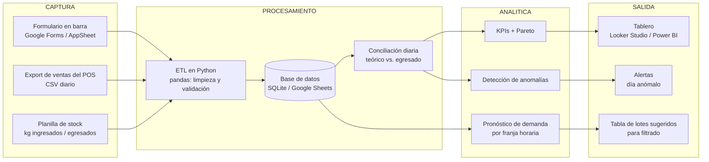

# 07 · Solución tecnológica y alcance del proyecto

Rol profesional: **Técnico Superior en Ciencia de Datos e Inteligencia Artificial**.

## 1. Nombre de la solución

**"Vaso Lleno" – Sistema de medición, conciliación y predicción de mermas de café para cafeterías take away.**

## 2. Arquitectura



## 3. Módulos

| # | Módulo | Técnica | Herramientas de la carrera | Salida |
|---|---|---|---|---|
| M1 | **Captura** | Formulario con causas predefinidas, validación de rangos | Diseño de datos, BD relacional | Registro limpio |
| M2 | **Conciliación** | Reglas de negocio (receta × ventas) | SQL (JOIN ventas–recetas–stock), pandas | Tasa de merma diaria |
| M3 | **Analítica descriptiva** | KPIs, Pareto, carta de control | Estadística, visualización (Power BI) | Tablero |
| M4 | **Pronóstico de demanda** | Series temporales con rezagos, regresión lineal / Random Forest por franja de 30 min | Aprendizaje Automático, Minería de Datos | Tamaño de lote sugerido |
| M5 | **Anomalías** | Isolation Forest o límites ± 2σ sobre la tasa diaria | Minería de Datos | Alertas para revisar con el equipo |
| M6 | **Trazabilidad del residuo** | Registro de lote (hora de molienda → cold brew) | BD relacional | Lotes rotulados y vida útil |

### Modelo de datos (resumen)

```
recetas(id_bebida, nombre, gramos_cafe)
ventas(fecha, franja, id_bebida, cantidad)            ← POS
stock(fecha, kg_ingreso, kg_egreso, lote_cafe)
mermas(id, fecha, hora, turno, barista_id, causa, evitable, gramos, destino)
lotes_valorizacion(id_lote, fecha_molienda, hora_molienda, gramos, producto, fecha_elaboracion, vence)
```

### Consulta clave (conciliación diaria)

```sql
-- Justificación: compara lo que "debería" haberse usado según la receta con lo que realmente salió del stock
SELECT v.fecha,
       SUM(v.cantidad * r.gramos_cafe)                     AS teorico_g,
       s.kg_egreso * 1000                                  AS egresado_g,
       1 - SUM(v.cantidad * r.gramos_cafe) / (s.kg_egreso * 1000) AS tasa_merma
FROM ventas v
JOIN recetas r ON r.id_bebida = v.id_bebida
JOIN stock   s ON s.fecha     = v.fecha
GROUP BY v.fecha, s.kg_egreso;
```

## 4. Alcance

### Dentro del alcance
- **1 cafetería take away piloto** (socio de campo), con posibilidad de una segunda como control.
- Café molido para **espresso y filtrado** (las bebidas con leche se calculan por sus gramos de café).
- Módulos **M1, M2, M3 (MVP obligatorio)**; **M4 y M5** si hay ≥ 4 semanas de datos.
- **Piloto de cold brew elaborado y vendido en el local**, con trazabilidad.
- Política de consumo interno (OE4) como **propuesta documentada**.

### Fuera del alcance (fases futuras)
- **Envasado para venta fuera del local.** Según el Código Alimentario Argentino, comercializar alimentos envasados exige inscripción del establecimiento (RNE) y del producto (RNPA); sin esos números el producto no puede venderse. Además, el cold brew envasado exige un estudio de vida útil y control microbiológico.
- Cambio de equipamiento (molino) – sólo se recomienda si el Pareto real lo justifica.
- Integración automática con la API del POS (en el MVP se usa la exportación CSV).
- Gestión del grano verde y del tueste (eso pertenece al proyecto de tesis de tueste).

### Supuestos
- El local permite registrar durante 6-10 semanas y comparte ventas diarias por tipo de bebida.
- Existe una receta estándar (gramos por bebida) o se puede definir con el encargado.
- Se dispone de al menos una balanza de 0,1 g.

### Restricciones
- Tiempo de registro por evento: **≤ 10 segundos**, si no, el equipo deja de registrar.
- Cero impacto negativo en la atención en hora pico.
- Datos por barista **anónimos** en el informe final.

## 5. Entregables

1. Informe de línea base (Pareto real, costo de la merma).
2. Notebook reproducible + base de datos.
3. Tablero de KPIs.
4. Protocolos de barra (dosis, purga, calibración, cierre).
5. Ficha técnica y protocolo de trazabilidad del cold brew.
6. Informe de evaluación antes/después.
